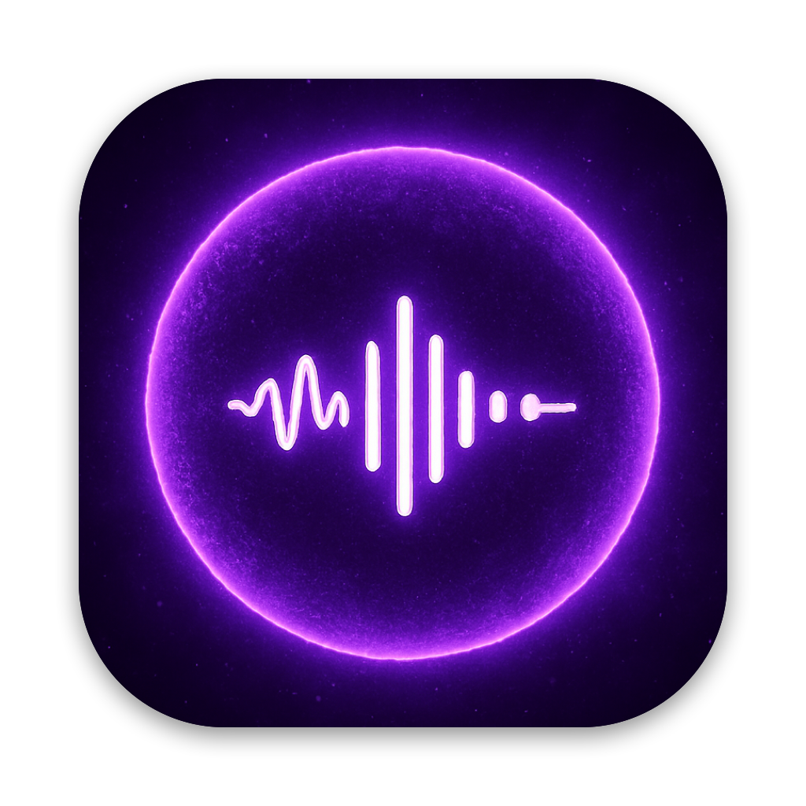

<p align="center"></p>

# Vocalizer for Mac

**Removes the music from anything your Mac plays and keeps the voices.** YouTube, Apple Music, Spotify, podcasts,
any app. It runs entirely on your Mac (Neural Engine), and with the optional audio device it keeps video lips in
sync with the voice.

<p align="center"></p>

## Install

Needs an **Apple silicon Mac** (M1 or later) on **macOS 14.2+**. Paste into Terminal:

```bash
curl -fsSL https://raw.githubusercontent.com/0xArx/vocalizer-mac/main/install.sh | bash
```

That downloads the latest release, puts **Vocalizer** in Applications, installs the Vocalizer audio device (macOS
asks for your password once) and opens the app. Then:

1. Click the **microphone icon** in the menu bar and switch it on.
2. macOS asks to allow **System Audio Recording**: click **Allow**.
3. Play something. The music is gone; the voices stay.

Installing with a coding agent (Claude Code, Codex, Cursor...)? Just ask it to "install Vocalizer from
github.com/0xArx/vocalizer-mac". It follows [AGENTS.md](AGENTS.md). There is also a ready-made agent skill in
[`skills/install-vocalizer`](skills/install-vocalizer/SKILL.md).

<details>
<summary>Other ways to install</summary>

- **Without the audio device** (no video sync, no password): `curl -fsSL .../install.sh | bash -s -- --no-driver`
- **Build from source** (needs Xcode or `xcode-select --install`):
  `curl -fsSL .../install.sh | bash -s -- --from-source` (add `--with-speech` for Speech mode; needs `brew install rust`)
- **Manually:** download `Vocalizer-macOS.zip` from [Releases](https://github.com/0xArx/vocalizer-mac/releases),
  move `Vocalizer.app` to Applications, open it, and use **Install…** in its menu for the audio device. Because the app
  is not notarized yet, macOS may block the first launch: System Settings › Privacy & Security › **Open Anyway**.
- **For development:** `git clone`, then `scripts/build-app.sh --install` (see [AGENTS.md](AGENTS.md)).

</details>

**Uninstall:** `curl -fsSL https://raw.githubusercontent.com/0xArx/vocalizer-mac/main/uninstall.sh | bash`

## Using it

| Mode | Delay (sync on) | Best for |
|---|---|---|
| **Fast** (default) | about 0.4 s | everyday videos, music with singing |
| **Clean** | about 2 s | music apps, cleaner voices |
| **Best** | about 7 s | the cleanest voices, with video sync on (one-time 400 MB download) |
| **Speech** | about 0.15 s | talks, vlogs, calls. Also removes singing |

(In the code and the measurements below these are `live`, `quality`, `supreme` and `ultra`; `balanced` still exists
but is no longer offered in the menu.)

- **Settings** (folded away in the menu): **Fast only** (hides the mode tiles and always uses Fast: the menu is
  then just the switch and where it plays), **Keep video in sync**, **Open at login**, and with sync off, which app
  to filter. Everything else is the switch, the mode and where it plays.
- **Keep video in sync** (on by default): all sound goes through the *Vocalizer* audio device, which tells video
  players the delay, so the picture waits for the voice. Your speakers or headphones stay the real output, the volume
  keys keep working, and your speakers come back when you switch it off or quit.
- **Headphones / AirPods:** plug them in and the sound moves there (unplug and it goes back). The output list in
  Control Center shows **Vocalizer (your headphones)** so you can see where the sound really goes, and the
  **Output** picker in the Vocalizer menu switches it directly.
- With sync off, you can pick a single app to filter (Source).
- **Mute swear words** (switch in the menu): silences swear words, recognised on your Mac by Apple's speech
  recognition (macOS 26+), with **no added delay**. It works inside the delay each mode already has, so it depends on
  the mode. Measured on a test clip with 7 swear words over music: **Best** silences 6 of 7 precisely, **Clean** 5 of
  7 (sometimes clipping part of the next word), **Fast/Speech** can't (a word plays before it can be recognised).
  The misses were words the recogniser misheard. Delay with the filter on vs off: 7.36/7.27 s vs 7.26/7.45 s (Best).
- **⌥⇧V** (Option-Shift-V) switches it on or off from anywhere.
- **Waiting is visible.** With Best (and Clean), videos hold their picture until the voice arrives: the menu shows
  "Video starts in 6 s" with a progress bar, a countdown ring appears in the middle of the screen (like the volume
  pop-up; click-through, works over full-screen video, can be turned off in Settings), and the menu bar icon turns
  into an hourglass, after switching mode and
  each time sound starts again (a new video, play, or seeking). Best loads in the background with a spinner on its
  tile while the current mode keeps playing (it used to freeze the menu for ~6 s).
- **Open at login** is in the menu; Vocalizer remembers whether it was on.
- When a new version is out, the menu shows **Update**: one click runs the installer and reopens the app.
- Things that can't wait (games, live calls) still hear the delay. Use Speech mode for calls.
- Video sync is verified for long delays too: with Supreme's ~7.2 s, Chrome held the picture for 7.1 s and Apple's
  player (Safari, QuickTime, TV) for 7.4 s before playing, then played smoothly.

## Privacy

Everything runs locally. Audio is never recorded to disk or sent anywhere. The app makes only two kinds of
network requests, both to GitHub: a version check once a day (the latest release number), and the one-time
download of the Supreme model when you click **Download** in Supreme mode.

## How it works

```
Apple Music / Safari / Chrome / Spotify ...
        │ (muted by the tap)
        ▼
CATapDescription(stereoMixdownOfProcesses:) ──▶ private aggregate device ◀── default output device (clock master)
                                                     │ IOProc (real time, lock-free rings)
                       inRing ◀──────────────────────┤──────────────────────▶ outRing (primed with step + jitter)
                         │                                                          ▲
   worker thread: 48 kHz → 44.1 kHz → STFT (vDSP) → MDX-Net (Core ML, Neural Engine) → iSTFT → 44.1 → 48 kHz
```

- **One clock.** The tap and the output device live in the same private aggregate device, so input and output
  never drift and one IOProc both reads the tap and writes the vocals.
- **Helpers are grouped.** Chrome plays through "Google Chrome Helper", Safari through `com.apple.WebKit.GPU`.
  The picker groups every Core Audio process under its responsible app, so picking "Chrome" taps all of them.
  *All audio* is a global tap that excludes Vocalizer itself.
- **Sliding window instead of look-ahead.** Live audio has no future to read, so every `step` the model runs on the
  latest window and keeps a segment that ends `rightContext` before the window's valid edge. Segments crossfade.
  Delay = `trim (87 ms) + rightContext + step` + jitter buffer + IO. See `StreamingSeparator.swift`.
- **The network is convolutional in time** (its MatMuls act on frequency), so the ONNX model converts to Core ML at
  any window that is a multiple of 32 frames. Windows of 32, 64 and 256 frames ship (0.74 s, 1.5 s, 5.9 s).

## Measured

MacBook (Apple silicon), macOS 27.0.1, output through a 48 kHz USB device. Model in fp16 on the Neural Engine
(Core ML output vs the ONNX fp32 model: 42–45 dB SNR).

### Model speed per call (Core ML)

| Window | Audio covered | Neural Engine | GPU | 
|---|---|---|---|
| 256 frames | 5.94 s | **99 ms** (60× real time) | 313 ms |
| 64 frames | 1.49 s | **24–31 ms** | 80 ms |
| 32 frames | 0.74 s | **12 ms** | 42 ms |

The browser extension's WebGPU path took about 1.2 s per 256-frame chunk; the Neural Engine is about 12× faster.

### Quality vs delay (offline benchmark, same audio for every row)

MUSDB18 sample set, 16 test excerpts with singing (109 s), SDR of our vocals against the true vocal stem.
"Doing nothing" (the mix itself) scores −3.8 dB.

| Mode | Window / step / future context | Algorithmic delay | SDR (all) | SDR (median song) | Compute (RTF) |
|---|---|---|---|---|---|
| Offline-like (reference) | 256 / 1 s / 2.4 s | 3.5 s | 10.39 dB | 11.16 dB | 0.12 |
| **Quality** | 256 / 1 s / 0.5 s | **1.59 s** | 10.38 dB | 10.96 dB | 0.12 |
| **Balanced** | 64 / 93 ms / 70 ms | **250 ms** | 10.10 dB | 10.89 dB | 0.33 |
| **Live** | 32 / 46 ms / 23 ms | **157 ms** | 9.80 dB | 10.39 dB | 0.37 |
| 32 / 46 ms / 12 ms | | 145 ms | 9.77 dB | 10.35 dB | 0.35 |

Going from 3.5 s to 157 ms of delay costs about 0.6 dB. The model barely needs future context, which is why a
live mode works at all. (Synthetic speech over synth music: 20 dB offline, 19 dB Live.)

### Real system path (loopback test inside the app)

`afplay` plays the MUSDB excerpts; the app taps it (muted), and two extra unmuted taps on the same aggregate
device record the original and Vocalizer's output, so the delay is measured sample-exactly by cross-correlation.

| Mode | Measured delay (tap in → our output) | Engine estimate | SDR vs true vocals | Compute (RTF) | Underruns |
|---|---|---|---|---|---|
| Live | 255 ms | 250 ms | 10.75 dB | 0.54–0.60 | 0 |
| Balanced | 348 ms | 343 ms | 11.23 dB | 0.48 | 0 |
| Quality | 1876 ms | 1870 ms | 11.67 dB | 0.16 | 0 |

(Each run covers a different 12–13 s stretch of songs, so compare SDR across modes with the offline table above.)
Delay = algorithmic delay + one step of buffering + 60 ms jitter buffer (250 ms in Quality) + ~25 ms IO.

The engine's own latency estimate is within a few ms of the measured value, so the menu's number is trustworthy.
Add the output device's own latency (13 ms on this USB device; Bluetooth headphones add 150–250 ms more).
No underruns in any run.

### Apple Music (DRM)

**Apple Music streaming (FairPlay) is capturable.** With an Apple Music catalog track playing, the tap on
`com.apple.Music` delivered the real signal (RMS 0.07–0.18), the app was muted, and separated vocals played.
Tested on streamed catalog tracks; no Apple Music downloads were on this Mac, but they decode in the same process.
(Video DRM in Safari, e.g. Netflix, was not tested.)

### Video sync (virtual device)

`Driver/` builds `Vocalizer.driver`, an AudioServerPlugIn made from BlackHole's loopback driver
(GPL-3.0, `Driver/LICENSE-BlackHole`; `Driver/patch.py` renames it and adds a custom `'vlat'` property that sets
the device's output latency). The app taps everything sent to the device (a device tap, so no microphone
permission is needed) and plays the vocals on the real output through the same aggregate device as before.

- Sync path, Live mode: measured 394 ms delay vs 390 ms estimated, 10.6 dB SDR, no dropouts.
- Chromium sees the reported delay: `AudioContext.outputLatency` is **408 ms** through the Vocalizer device
  set to 400 ms, vs 16 ms on the USB speakers. Chrome paces video by the same output delay. Safari/AVFoundation
  also honour device latency (standard behaviour; not separately measured here).
- **The delay is fixed while playing.** It is reported once per start and the engine holds playback exactly at it:
  after a rare dropout it skips ahead rather than growing the buffer, and it never re-reports. An earlier build
  updated the delay after dropouts and could restart itself on its own output switches; each change made the video
  visibly re-sync (stutter and catch-up).
- Measured in real Chrome with the app running (sync, Live): 361 frames in 12 s at 30 fps, 0 freezes, 0 skipped,
  0 dropped; `outputLatency` steady at 416 ms; one engine start, 0 underruns over the run.
- Apps read the latency only when they open the device. When the delay changes by more than 25 ms (mode switch,
  e.g. Live to Quality, or speakers with a different latency), the app moves the default output to the real
  speakers for 0.8 s and back, so players reopen and re-read it. An instant away-and-back switch is not enough:
  Chrome coalesced it and kept the old delay (video 1.5 s ahead after Live to Quality; measured). The hold is
  silent because the tap mutes every app wherever it plays. In Chrome the video then pauses once (about 1.5 s
  for Live to Quality) and stays in sync. A restart with the same delay (e.g. after wake) does not re-sync at all.

### Supreme mode (MelBand RoFormer)

A transformer separator (MelBand RoFormer vocals by Kimberley Jensen, MIT) converted to Core ML with
`tools/convert_roformer.py` (network only; STFT, mask averaging over overlapping mel bands and iSTFT run in
`RoformerSeparator.swift`). It runs on the GPU: about 1.6 s per 8 s window (the Neural Engine is 3x slower for this
model, and 8-bit weights are 8x slower, so it ships as fp16, 403 MB, downloaded on first use from the `models-v1`
release). Every 3 s it separates the latest 8 s window with 1.5 s of future context; the playback buffer covers a
whole model call, so the delay is about 7 s, which video sync hides.

Same 60 s of MUSDB18 songs, SDR against the true vocals:

| | SDR | median per song |
|---|---|---|
| MDX-Net Quality (Core ML) | 10.56 dB | 11.08 dB |
| BS-RoFormer viperx 1296 (PyTorch reference, not shipped: 3x heavier, unclear license) | 11.61 dB | 12.64 dB |
| MelBand RoFormer reference (audio-separator, PyTorch) | 11.11 dB | 12.35 dB |
| **Supreme** (our streaming Core ML version) | **11.69 dB** | **13.25 dB** |

Real system path (loopback, sync on): measured delay 7.13 s vs 7.12 s estimated, **12.35 dB**, 0 underruns,
GPU busy about 57 % of the time.

### Speech mode (DeepFilterNet3)

A speech enhancement model (github.com/Rikorose/DeepFilterNet, MIT/Apache-2.0) that treats music as noise:
48 kHz, 10 ms frames, 2 frames of look-ahead (31 ms algorithmic), about 4.5 ms of CPU per 10 ms frame for stereo.
Built from source with `cargo build --release -p deep_filter --no-default-features --features capi` (Rust from Homebrew);
`scripts/build-deepfilter.sh` builds it (pinned commit) and `scripts/build-app.sh` bundles it when present.

| Same audio as above | Delay | SDR |
|---|---|---|
| Speech over synthetic music | 31 ms | 9.5 dB (MDX Live: 19.0) |
| Real songs (MUSDB18) | 31 ms | 1.2 dB (MDX Live: 9.8; doing nothing: −3.8) |

So Speech mode is for spoken content; for singing use Live (or Quality with sync on).

## Where it works

Tested on this Mac (MacBook Air, USB speakers + built-in speakers):

| | |
|---|---|
| Apple Music (FairPlay streams) | ✅ captured and separated |
| Video in Chrome, sync on | ✅ 30 fps, 0 dropped frames, delay steady (416 ms) |
| Apps pinned to a specific speaker | ✅ caught (sync mode uses a global tap); vocals play on your chosen speakers |
| Volume keys / mute, sync on | ✅ passed through to the real speakers (software gain if they have no volume control) |
| Switching speakers while playing | ✅ follows (USB ↔ built-in), no dropouts |
| Speakers unplugged | moves to the next output (logic tested by switching; not physically unplugged) |
| Supreme (~7.2 s) video sync | ✅ Chrome `outputLatency` 7208 ms, picture waits 7.1 s; AVPlayer waits 7.4 s (0.25 s on plain speakers) |
| Force quit / crash | ✅ speakers restored as the default output: signal handler, a watchdog process for `kill -9` / crashes (tested), and a check at launch |
| Mono or multichannel outputs | uses the device's preferred stereo pair, mono gets (L+R)/2 (stereo verified; others by code) |
| Sleep / wake | restarts the pipeline on wake (not tested here) |

Not tested: AirPlay outputs (none available), Netflix/Disney+ in Safari, Firefox video sync.
Delay can't be hidden from calls and games (use Speech mode, ~0.15 s with sync on).

## Limits found

- **Delay is unavoidable, but hidden with sync on.** Without the virtual device, Live is about 0.3 s behind the source
  and lips visibly lead the voice. With **Keep video in sync**, players delay the picture to match.
  Things that cannot be delayed (games, live calls) still hear the delay; use Speech mode for those.
- **Small pops (fixed).** The Neural Engine occasionally takes 100–175 ms for a 20 ms call. The output buffer now
  grows by 40 ms after any dropout and fades out/in around it, so it settles without clicks; Live starts with a
  100 ms buffer (sync mode 200 ms, hidden from video).
- **Quality on real songs is ~10–11 dB SDR**, the same as the offline model: reverb tails, backing vocals and some
  synths leak through; heavily processed vocals can lose some body. The model's weak right edge costs well under 1 dB
  in Live mode.
- **Neural Engine timing is spikier when called often.** In the app, 32-frame calls take ~20 ms instead of 12 ms
  (the ANE seems to idle between 46 ms steps), so Live runs at RTF ~0.55. Still under 1 with headroom; the 60 ms
  jitter buffer absorbs spikes.
- **System Audio Recording permission** is required and only granted to app bundles; a bare command line tool
  receives silence. Re-signing with a different identity asks again.
- **Output device changes** restart the pipeline (a short gap). Sample-rate changes on the fly are not handled
  beyond that restart.
- *All audio* also captures system sounds and notifications and runs them through the model.
- System volume applies to Vocalizer's output as normal.
- Not notarized; it is a local prototype.

## Files

Developers and agents: see [AGENTS.md](AGENTS.md) for the build, layout and rules.


| | |
|---|---|
| `Sources/VocalizerCore/MDXSpectrogram.swift` | STFT/iSTFT matching UVR (port of the extension's `mdx.js`, vDSP DFT of 7680 = 15·512) |
| `Sources/VocalizerCore/MDXModel.swift` | Core ML wrapper (strided output, Neural Engine) |
| `Sources/VocalizerCore/StreamingSeparator.swift` | sliding-window separation and the three presets |
| `Sources/VocalizerCore/VocalizerEngine.swift` | process tap, aggregate device, IOProc, rings, worker thread, stats |
| `Sources/VocalizerCore/AudioProcesses.swift` | Core Audio process list grouped by responsible app |
| `Sources/VocalizerCore/LoopbackTest.swift` | end-to-end test (run inside the app: `--selftest`) |
| `Sources/VocalizerMac/` | SwiftUI menu bar app (`--list`, `--selftest`, `--snapshot` for testing) |
| `Sources/vocalizer-bench/` | offline benchmark: SDR, latency, speed per config |
| `tools/` | model conversion, fixtures, loopback analysis (Python venv) |

## Tests and tools

```bash
# Python tools (conversion + fixtures + analysis)
python3.11 -m venv tools/.venv && tools/.venv/bin/pip install onnx onnx2torch torch coremltools numpy onnxruntime musdb

# Models: ONNX -> Core ML (window sizes as arguments)
tools/.venv/bin/python tools/convert.py UVR-MDX-NET-vocals.onnx Models 256 64 32   # the UVR MDX-Net vocals ONNX (n_fft 7680)

# Fixtures: synthetic (say + synth music) and real music (MUSDB18 7 s samples, 140 MB download)
tools/.venv/bin/python tools/make_fixture.py fixtures
tools/.venv/bin/python tools/make_musdb_fixture.py fixtures

# Offline benchmark (presets, or the full sweep), optionally on cpu|gpu|ane|all
swift build -c release && .build/release/vocalizer-bench Models fixtures/musdb-fixture all presets

# End-to-end loopback through the real system path (plays audio out loud for N seconds)
ffmpeg -f f32le -ar 44100 -ac 2 -i fixtures/musdb-fixture/mix.f32 -t 60 fixtures/musdb-mix.wav
open -W -n build/Vocalizer.app --args --selftest $PWD/fixtures/musdb-mix.wav 16 live $PWD/fixtures/app-live
tools/.venv/bin/python tools/analyze_loopback.py fixtures/app-live fixtures/musdb-fixture

# Tap a running app instead of afplay
open -W -n build/Vocalizer.app --args --selftest app:com.apple.Music 12 live $PWD/fixtures/app-music
```

## Credits and licenses

- **Vocalizer app code:** MIT, see [LICENSE](LICENSE).
- **Audio device (`Driver/`):** based on [BlackHole](https://github.com/ExistentialAudio/BlackHole) by Existential
  Audio, **GPL-3.0** ([Driver/LICENSE-BlackHole](Driver/LICENSE-BlackHole)). The full source of the modified driver
  is in `Driver/`.
- **Supreme model:** [MelBand RoFormer vocals](https://huggingface.co/KimberleyJSN/melbandroformer) by
  Kimberley Jensen (MIT), architecture by lucidrains / ZFTurbo, converted to Core ML here.
- **Vocal model:** UVR MDX-Net vocals by the [Ultimate Vocal Remover](https://github.com/Anjok07/ultimatevocalremovergui)
  team (MIT, credit requested), converted to Core ML here. MDX-Net architecture by KUIELab.
- **Speech mode:** [DeepFilterNet](https://github.com/Rikorose/DeepFilterNet) by Hendrik Schröter (MIT / Apache-2.0).
- Test data (not included): MUSDB18 7-second samples.
